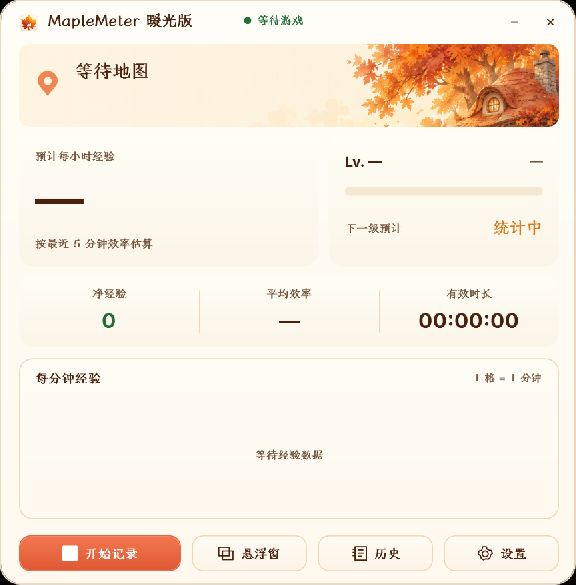
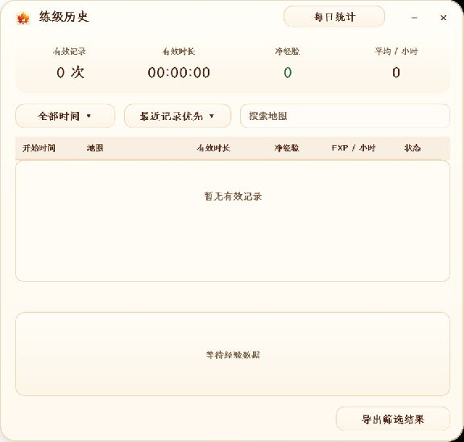
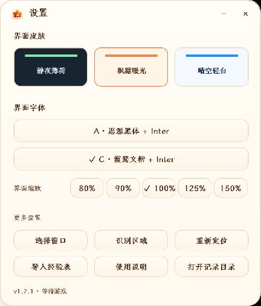

# MapleMeter Warm · Classic World 经验统计

**专为 MapleStory Classic World 英文经典客户端制作的练级小工具。**

这一小时能打多少经验？还要多久升级？打开软件，就能看到经验效率、升级预估和练级记录。

**[下载最新版](https://github.com/Deliuu/MapleMeter-Warm/releases/latest)** · Windows x64

## 看看界面

以下为正常运行时的实际截图。当前未连接游戏，历史暂无记录；点击图片可查看大图。

| 主界面 | 练级历史 | 外观设置 |
| :---: | :---: | :---: |
|  |  |  |

## 能做什么

- **看效率**：预计每小时经验、本次净经验、平均效率、每分钟经验变化。
- **看升级时间**：内置 Classic World 升至 100 级的经验表，估算还要多久升级。
- **留记录**：查看历史与最近 7 / 30 天统计，也能导出 CSV。
- **自动暂停**：15 秒没有游戏前台键鼠操作时暂停，识别到经验变化后恢复；也可以手动控制。
- **换外观**：内置 **3 套皮肤**——静夜薄荷、枫糖暖光、晴空轻白；**2 套中文字体**——思源黑体、霞鹜文楷。英文和数字使用 Inter，界面大小也能调整。

## 怎么用

1. 在 [Releases](https://github.com/Deliuu/MapleMeter-Warm/releases/latest) 下载 **`MapleMeter-Warm-Windows-x64.zip`**，不要选 `Source code`。
2. **完整解压**，双击 `MapleMeter-Warm.exe`。不要只拿走 EXE，其他文件也要保留。
3. 打开 Classic World，展开左上角小地图，保持底部经验栏可见，软件会自动开始记录。
4. 识别不到时，进入 **设置 → 选择窗口 / 重新定位 / 识别区域**。

运行需要 Windows x64 和 .NET Framework 4.x / WPF，建议 Windows 10 或 11。不用另装 Python 或 OCR 软件。

| 快捷键 | 功能 |
| --- | --- |
| `Ctrl + Alt + 空格` | 暂停 / 继续 |
| `Ctrl + Alt + L` | 返回主窗口 |

## 几点说明

- **预计每小时经验**按最近最多 5 分钟的有效记录估算，不是未来一定能获得的经验。死亡掉经验会扣除，暂停和奖励经验也会影响结果。
- **历史记录**只保留有效时长超过 10 分钟的记录；短记录可计入每日统计。请正常结束记录或退出，连续暂停 15 分钟也会自动结束并保存。
- 游戏最小化、经验栏被挡住或客户端布局变化时，识别可能中断。
- 记录和设置存在 **`%LOCALAPPDATA%\MapleMeter-Warm`**，也可从 **设置 → 打开记录目录** 找到。换电脑时复制这个文件夹即可迁移记录。
- 软件在本地识别屏幕，不读取游戏内存、不自动操作游戏，正常使用不保存或上传游戏截图。分享日志前请检查其中的本机路径。

普通使用不需要编译。想修改源码，可以看 [开发说明](docs/BUILD.md)。

## 致谢

感谢以下项目和资料：

- [NiaMeowDB](https://meowdb.com/msclassic/guides/exp-table-level-1-to-100) 与 [MapleClassic Wiki](https://mapleclassic.wiki/index.php?title=Experience&oldid=89094)：Classic World 经验表与交叉核对资料。
- [Tesseract OCR](https://github.com/tesseract-ocr/tesseract)、[Leptonica](https://github.com/DanBloomberg/leptonica)：屏幕文字识别与图像处理。
- [思源黑体](https://github.com/adobe-fonts/source-han-sans)、[霞鹜文楷](https://github.com/lxgw/LxgwWenKai)、[Inter](https://github.com/rsms/inter)：界面字体。

本项目由 **GPT-6-astra** 协助构建，结合使用者的需求与反馈迭代。界面插画与图标由 AI 生成。第三方说明及许可证见 [THIRD-PARTY.txt](THIRD-PARTY.txt) 和 [字体目录](assets/fonts)。

## 免责声明

本项目是非官方工具，与 MapleStory、Classic World 及其运营方没有隶属或合作关系，相关名称和游戏素材归原权利人所有。

识别结果和升级时间仅供参考，可能受画面、版本和暂停状态影响。请自行确认游戏规则是否允许使用此类工具；项目不保证识别准确性、所有电脑的兼容性或账号使用安全。使用前请备份重要记录。